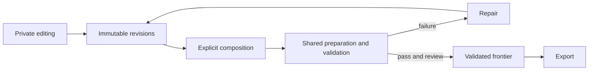

# Patchweft

**Shared source and execution for coding agents.**

Patchweft helps several agents work on one codebase without losing track of what
they changed, which work can be shared, and whether their changes work together.
Agents publish immutable revisions, request builds or tests, and compose their
changes explicitly. A failed composition stays available for repair while
independent work continues.

Use it when agents repeat expensive preparation, need each other's unfinished
work, or produce individually passing changes that fail together. Projects supply
their own commands and validation policy. There is no required language, model
provider, repository layout, or hosted account.

Patchweft is an MIT-licensed Rust service, CLI and MCP adapter. Version 0.1 runs
on one Linux host for trusted collaborators. Remote agents can connect over an
authenticated API; execution stays on that host. Its current boundaries are
documented in [operations](docs/operations.md).

## How work moves



- **Publish without waiting.** Checkpoint an editing workspace without changing its
  files, HEAD or staging. Other agents can consume that revision immediately.
- **Share useful computation.** Identical outstanding requests share one execution.
  Preparation artifacts feed separate downstream workspaces. Completed-result reuse
  requires an explicit policy and input audit.
- **Check the combination.** A candidate names one revision, one execution profile
  and any real prerequisites. Passing changes still need validation when composed.
- **Keep unrelated work moving.** Failed candidates create repair records. Retry
  retains successful obligations; cancellation detaches the requesting owner's interest.
- **Export recorded evidence.** Frontier promotion requires passing obligations,
  exact-revision review, ancestry and a compare-and-swap. The retained certificate
  identifies the source, profile and execution evidence.

## Build and try

Requirements: Linux with `/proc`, Git at `/usr/bin/git`, a C/C++ build toolchain,
and Rust through rustup. The pinned Rust version is in
[rust-toolchain.toml](rust-toolchain.toml). The example also needs Python 3.
On Debian or Ubuntu, the system prerequisites are:

```bash
sudo apt-get install build-essential git python3
```

With rustup installed:

```bash
git clone https://github.com/lumenloop/patchweft.git
cd patchweft
cargo build --release --locked
./target/release/patchweft --help
python3 examples/shared-prep/run.py --binary ./target/release/patchweft
```

The example creates a temporary Git project, gives two agents private workspaces,
publishes and composes their edits, then runs one preparation job and two consumers.
It verifies that the consumers receive independent copies and that only three
executions occurred. It cleans up its temporary project after success. No
credentials, network downloads or existing project are needed.

To install the built CLI into your own bin directory:

```bash
mkdir -p "$HOME/.local/bin"
install -m 755 target/release/patchweft "$HOME/.local/bin/patchweft"
```

Add that directory to your shell's `PATH` if needed.

## Use your project

[The walkthrough](docs/getting-started.md) takes a Git repository through
workspace creation, checkpoints, composition, validation, review and export.
All commands return JSON for agents and scripts.

| Guide | Purpose |
|---|---|
| [Getting started](docs/getting-started.md) | Import your repository and run its commands |
| [Execution profiles and preparation](docs/profiles.md) | Tools, dependencies, artifacts, reports and reuse |
| [Agent workflow](docs/agents.md) | Short instructions to give a coding agent |
| [Connections](docs/connections.md) | Remote CLI, HTTP, resumable events and MCP |
| [Operations](docs/operations.md) | Resource budgets, recovery, backups and current limits |
| [Design](docs/design.md) | Source identity, evidence and related open-source work |
| [Contributing](CONTRIBUTING.md) | Development prerequisites and checks |

Patchweft does not decide which tests are sufficient or prove that a reviewer is
independent. Operators choose certifying profiles and review policy. Native jobs
execute with the worker account's privileges; use a dedicated account with trusted
code. Slot and memory reservations control admission, not operating-system limits.

The name combines *patch*, a source change, with *weft*, the threads woven across
a fabric: independent changes forming a coherent codebase.
